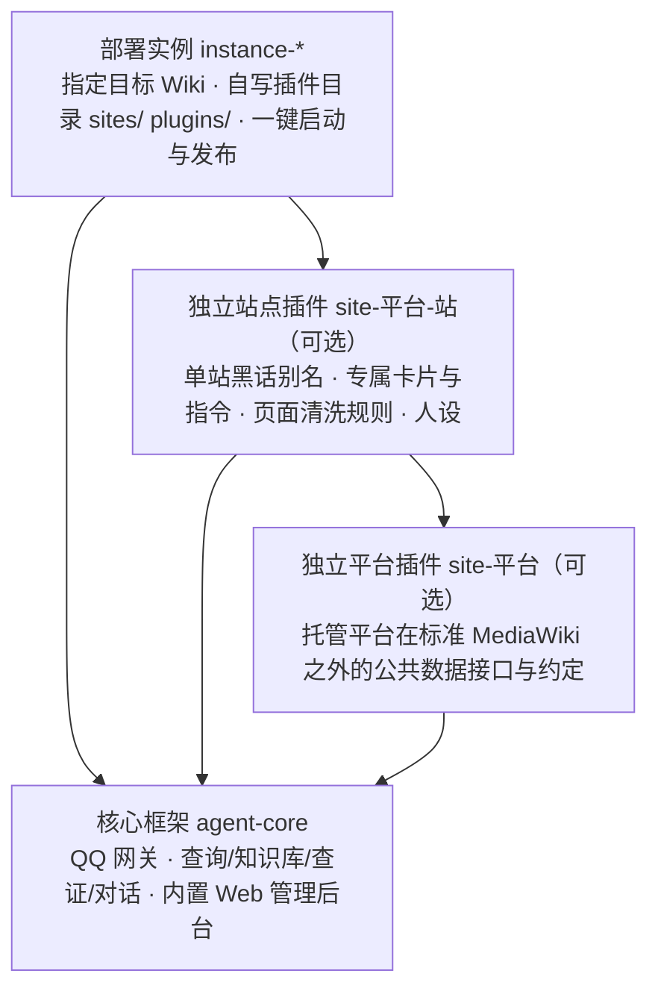

  <a href="https://github.com/JianShanAgent/agent-core">核心仓库</a> ·
  <a href="https://github.com/JianShanAgent/agent-core#快速开始">快速开始</a> ·
  <a href="https://github.com/JianShanAgent/agent-core#接入自己的-wiki-与编写插件">接入新 Wiki</a> ·
  <a href="https://github.com/JianShanAgent/agent-core/blob/main/docs/架构.md">系统架构</a> ·
  <a href="https://github.com/JianShanAgent/agent-core/blob/main/docs/插件规范.md">插件规范</a> ·
  <a href="https://github.com/JianShanAgent/agent-core/blob/main/docs/部署与运维.md">部署与运维</a>

## 项目简介

**JianShanAgent（见山）** 是一个面向 **MediaWiki** 站点的开源 **QQ 问答机器人框架**。

游戏玩家群或资料站社群里每天都有人问角色数值、技能机制、活动奖励，或者直接发张截图问皮肤出处。用纯关键词机器人只能机械匹配固定指令；直接接通用大模型又很容易混淆版本数值、编造不存在的词条链接。见山把精确查询与大模型查证结合在一起：

- **精确指令直查**：`/查`、`/筛选` 等指令直接请求 MediaWiki 接口或站点结构化数据，1～2 秒返回排版卡片，不经过大模型、不编造数据。
- **多步查证问答（RAG + 独立复核）**：自然语言提问先拆解问题与角色外号，去本地向量知识库和 Wiki 站内实时搜索取证，生成回答后再经过一道独立复核，剔除资料里没写的猜测与未核实的链接，最后附上参考词条出处。
- **以图搜图与每小时自动同步**：用图文同空间的向量模型索引站内立绘、皮肤与图标，支持发图识出处；后台 `kbsync` 进程每小时检查 MediaWiki 最近更改，自动增量更新知识库。
- **开箱自带 Web 管理后台**：已内置编译好的网页控制台（无需安装 Node.js），支持查看每条问答的完整检索与复核链路、网页端直接对话调试、热更新配置与插件开关。

目前线上生产实例服务于[灰机阴阳师 Wiki](https://yys.huijiwiki.com)（已索引约 7,700 篇文档、1.4 万个知识切片与 3,000 张图片）。

下面是管理后台里一条提问的处理过程：问「高铁的三技能叫什么」，它认出「高铁」是大天狗·高天铁羽，查知识库和站内搜索，写结论，复核通过后才发出去。

JianShanAgent is an open-source QQ bot framework for MediaWiki sites, featuring direct structured lookups, multi-step RAG with answer verification, reverse image search, incremental wiki sync, and a built-in web console.

## 三步跑起来（任选 Python 原生直跑或 Docker）

新建一个你自己的机器人不需要克隆全部仓库，只需要基于 **[`template-instance`](https://github.com/JianShanAgent/template-instance)** 创建一个实例仓库即可（核心框架与内置网页后台会通过依赖自动拉取）：

1. **创建实例并填配置**：使用 `template-instance` 模板新建仓库，在 `config/core.wiki.yaml` 填入你的 MediaWiki `api.php` 地址，复制 `config/secrets.example.yaml` 为 `config/secrets.yaml` 填入大模型与 QQ 机器人密钥。
2. **选择你顺手的方式启动**：
   - **方式 A（Python / `uv` 原生直跑，免 Docker）**：安装 [`uv`](https://docs.astral.sh/uv/getting-started/installation/) 后直接执行 `uv sync && uv run jianshanagent`（本地不连 QQ 测试加 `JIANSHANAGENT_DRY_RUN=1`）。
   - **方式 B（Docker Compose 一键启动）**：直接执行 `docker compose up -d --build`，自动拉起机器人、每小时增量同步与 `pgvector` 数据库。
3. **打开网页后台调试与建库**：浏览器访问 `http://127.0.0.1:8080`（登录令牌第一次启动时自动生成：原生运行 `cat data/admin/token`，Docker 运行 `docker compose exec qqbot cat /data/admin/token`），在「网页对话」里直接测试问答；需要全量向量检索时执行 `knowledge run / embed / load` 三条命令即可。

完整操作说明请看 **[`agent-core` 快速开始](https://github.com/JianShanAgent/agent-core#快速开始)**。

## 仓库目录与职责划分

为了让核心框架与具体游戏资料彻底解耦，本组织按职责划分为以下仓库：

### 1. 核心框架

| 仓库 | 说明 |
|---|---|
| [`agent-core`](https://github.com/JianShanAgent/agent-core) | 机器人核心框架、7 个内置功能插件、预编译好的 Web 管理后台、Docker 编排与远程发布工具。**主文档与完整教程均在此仓库。** |

### 2. 脚手架模板（新建自己的机器人或插件时使用）

| 仓库 | 什么时候用它 |
|---|---|
| [`template-instance`](https://github.com/JianShanAgent/template-instance) | **新建机器人实例从这里开始**。自带配置骨架、`pyproject.toml`、`Dockerfile` 与 `docker-compose.yml`。自己写的专属插件也可以直接放在它的 `sites/` 或 `plugins/` 目录下随仓库一起同步。 |
| [`template-site-wiki`](https://github.com/JianShanAgent/template-site-wiki) | **单站插件模板**。当你希望把某个 Wiki 的清洗规则、别名映射、专属指令打包成独立仓库分享或复用时，从这里创建。 |
| [`template-site-platform`](https://github.com/JianShanAgent/template-site-platform) | **Wiki 平台插件模板**。当你要在同一个托管平台（如灰机、BWiki、Fandom）上接入多个 Wiki、需要抽离平台公共接口时使用；只接单个站不需要这一层。 |

### 3. 阴阳师 Wiki 线上实例（完整实战参考）

| 仓库 | 说明 |
|---|---|
| [`site-huiji`](https://github.com/JianShanAgent/site-huiji) | **灰机 Wiki 平台插件**（`id: huiji`）。封装灰机特有的 `Data:` 命名空间 JSON 接口、本地缓存与公共清洗规则。 |
| [`site-huiji-yys`](https://github.com/JianShanAgent/site-huiji-yys) | **阴阳师 Wiki 站点插件**（`id: yys`，上级 `huiji`）。实现式神/御魂结构化查询、外号词典、`/筛选` 指令，并接入公告、剧情、数据集与立绘图库。 |
| [`instance-yys`](https://github.com/JianShanAgent/instance-yys) | **阴阳师 Wiki 生产部署实例**。展示如何组装核心与多层外部站点插件并维护线上服务。 |

## 开源许可

本组织下全部仓库代码均基于 [MIT License](https://github.com/JianShanAgent/agent-core/blob/main/LICENSE) 开源。
