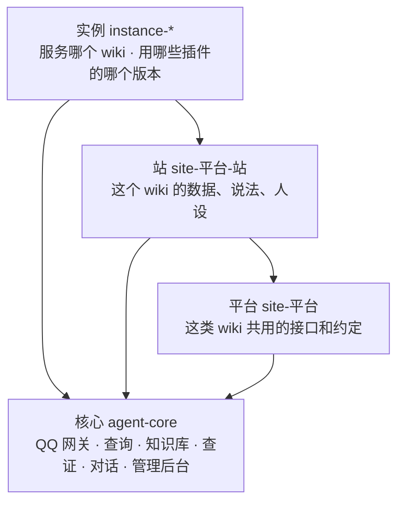

  <a href="https://github.com/JianShanAgent/agent-core#快速开始">快速开始</a> ·
  <a href="https://github.com/JianShanAgent/agent-core#接上你自己的-wiki">接上你自己的 wiki</a> ·
  <a href="https://github.com/JianShanAgent/agent-core/blob/main/docs/架构.md">架构</a> ·
  <a href="https://github.com/JianShanAgent/agent-core/blob/main/docs/插件规范.md">插件规范</a>

群里总有人问「这个角色的技能是什么」「上次那个活动奖励有哪些」。答案 wiki 上都有，只是没人想去翻。

**见山**是一个挂在 QQ 上的 wiki 问答机器人：在群里 @ 它问一句，它去 wiki 上把答案找出来，核对过再告诉你，后面附上出处。能直接查的不麻烦大模型，拿不准的先查证再开口，发张图它也认得。名字取自「开门见山」。

它为 MediaWiki 而写，现在在线上服务的是[阴阳师 wiki](https://yys.huijiwiki.com)。想给你自己的 wiki 也挂一个，从 [`agent-core`](https://github.com/JianShanAgent/agent-core) 的 README 看起。

JianShanAgent is a QQ bot that answers questions from a MediaWiki site — direct lookups without an LLM, retrieval-augmented answers that are reviewed before they are sent, and reverse image search. Site-specific behaviour lives in plugins. Documentation is in Chinese.

## 从哪看起

| 你想 | 去这里 |
|---|---|
| 知道它是什么、能做什么、怎么跑起来 | [`agent-core`](https://github.com/JianShanAgent/agent-core)：机器人本体，文档也在这里 |
| 给自己的 wiki 部署一个 | [`template-instance`](https://github.com/JianShanAgent/template-instance)：一个部署的骨架，复制下来填上 wiki 的地址 |
| 让它更懂你的 wiki | [`template-site-wiki`](https://github.com/JianShanAgent/template-site-wiki)：站点插件的骨架，多半只要写一份配置 |
| 好几个 wiki 建在同一个平台上 | [`template-site-platform`](https://github.com/JianShanAgent/template-site-platform)：平台插件的骨架 |
| 看一个真的在跑的例子 | [`site-huiji`](https://github.com/JianShanAgent/site-huiji)、[`site-huiji-yys`](https://github.com/JianShanAgent/site-huiji-yys)、[`instance-yys`](https://github.com/JianShanAgent/instance-yys)：灰机平台、阴阳师 wiki、和它的部署 |

## 它是怎么拼起来的

核心只懂 MediaWiki 和 QQ。某个 wiki 平台、某个站特有的东西是插件；把它们拼到一起、指向某一个 wiki 的，是实例。

仓库的名字就是按这个分的：`site-` 是站点插件，`instance-` 是部署，`template-` 是新建它们时用的骨架。规矩写在[插件规范](https://github.com/JianShanAgent/agent-core/blob/main/docs/插件规范.md)里。

全部仓库用 [MIT](https://github.com/JianShanAgent/agent-core/blob/main/LICENSE) 许可。
